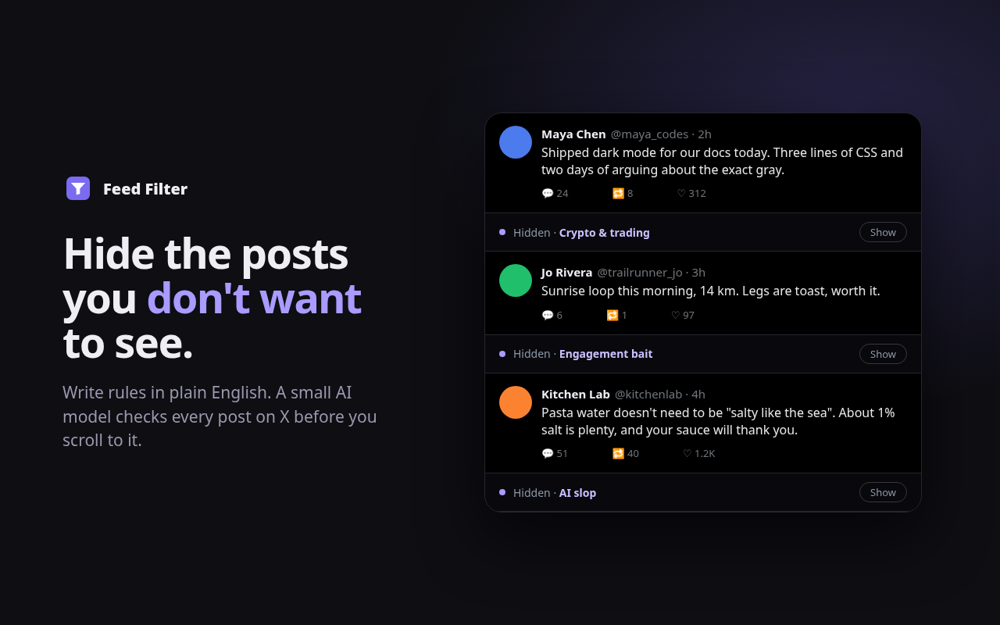
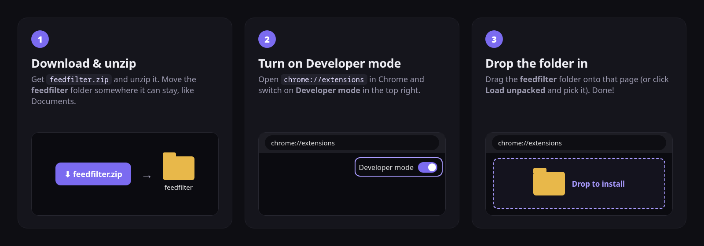

# Feed Filter

A browser extension that hides posts you don't want to see on X, using rules in plain English:
"hide crypto shilling", "hide engagement bait", "hide posts about celebrity gossip".
A small AI model runs **on your own GPU**. Nothing you see is sent anywhere.



Hidden posts collapse into a thin bar (`Hidden · Crypto & trading · Show`). Clicking **Show**, or
**Hide like this** on a post the filter missed, tunes that rule to your taste.

## Install (2 minutes)

### [⬇ Download Feed Filter](https://github.com/Wiskers790/feedfilter/releases/latest/download/feedfilter.zip)



1. **Download** [`feedfilter.zip`](https://github.com/Wiskers790/feedfilter/releases/latest/download/feedfilter.zip),
   unzip it, and move the `feedfilter` folder somewhere it can stay (Chrome runs it from there).
2. Open **`chrome://extensions`** and switch on **Developer mode** (top right).
3. **Drag the `feedfilter` folder onto that page**, or click **Load unpacked** and choose it.

The welcome page opens and the model (~450 MB) downloads once. Then open x.com and scroll.
Works in Chrome, Edge (`edge://extensions`), Brave and other Chromium browsers with WebGPU on a real graphics card,
which most computers from the last several years have.

**Updates:** when a new version is out, the extension's popup tells you. Download it again, replace the folder,
and click ↻ on the extension in `chrome://extensions`. Your rules and the downloaded model are kept.

**Linux laptops with an NVIDIA + Intel GPU:** if the popup says your computer isn't supported, start Chrome on the
NVIDIA GPU:
```bash
prime-run google-chrome-stable --enable-features=Vulkan
```

## Built-in rules
| Rule | Default | On our benchmark (at ~3% wrongly hidden) |
|---|---|---|
| Crypto & trading | on | catches 84% |
| Engagement bait | on (beta) | catches 29% |
| AI slop | on (beta) | catches 17% |
| Politics & outrage | off | catches 77% |
| Self-promotion | off (beta) | catches 7% |
| Sexual / NSFW | off | |

Beta rules are early. Better models are the next step.

## How it works
- **Model:** [vllm-sr/Decision-2.0-Kai-0.6B](https://huggingface.co/vllm-sr/Decision-2.0-Kai-0.6B) (Apache-2.0),
  a Qwen3-0.6B backbone plus a small head that answers yes/no questions with a probability. Each post is
  checked against all active rules in one pass (~0.4 s per post on an RTX 3050), nearest-to-screen first.
- **Browser build** (`model/`): `kai_ref.py` re-implements Kai's inference (matches the official package to
  0.007), `export_onnx.py` → `quantize.py` (4-bit MatMul) → `shrink_embed.py` (int8 embeddings) gives
  `kai_q4.onnx` (432 MB). The release files live in `model/release/` (Git LFS) and are published by tagging
  `model-v*`.
- **Extension** (`extension/src`, bundled by `npm run build`):
  - `engine.js`: ONNX Runtime Web on WebGPU, tokenizer, and the decision head in JS, in an offscreen page.
    Model files are cached in the browser after the first download.
  - `background.js`: routes requests and caches verdicts. `content_x.js`: X. `rules.js`: presets.
    `popup.js`, `welcome.js`: UI.

## Development
```bash
npm ci
npm run build
```
Load `extension/` unpacked. To serve the model locally instead of from the release, run a static server on
`model/release` at port 8777 and set `chrome.storage.local.set({modelBase: "http://127.0.0.1:8777/"})` in the
extension's service worker console.

Releases: bump the version in `extension/manifest.json`, tag `vX.Y.Z` and push; a workflow runs `npm run package` and
creates the release. The same zip is what gets uploaded to the Chrome Web Store (listing text in `store/LISTING.md`,
images rendered from `store/shots.html` by `store/render.py`).

## License
MIT for this code. The Kai model weights are Apache-2.0 (see `NOTICE`).
